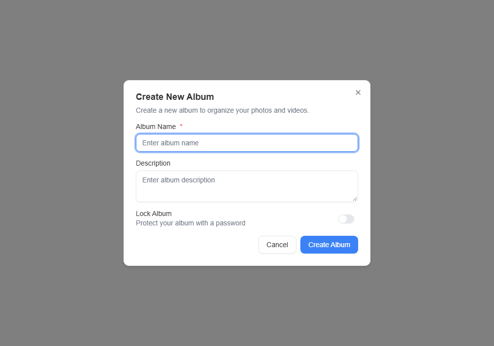
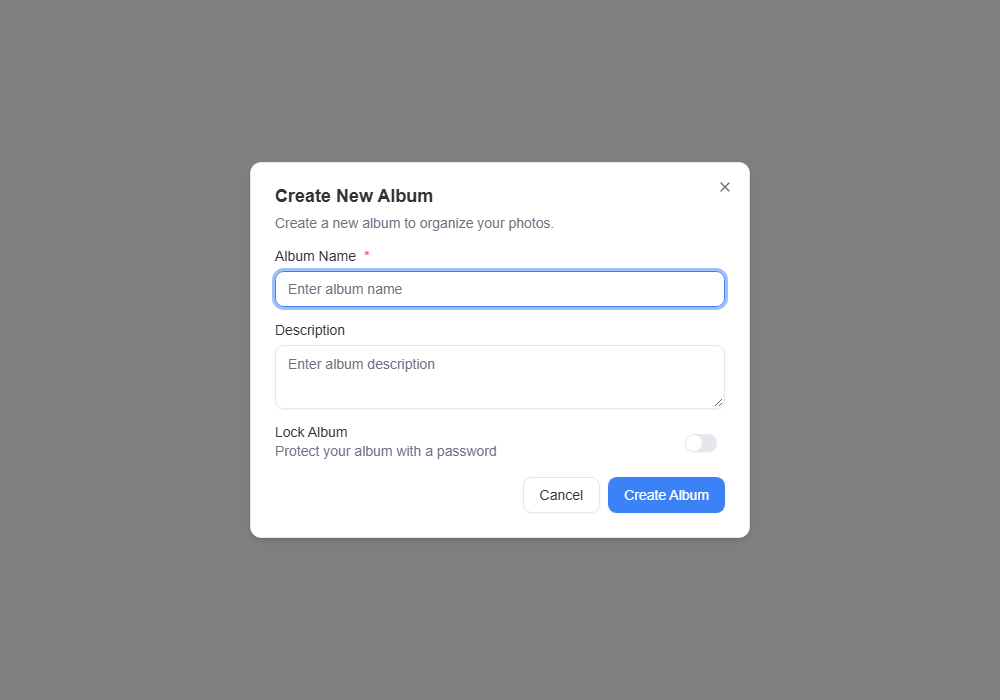

# PictoPy issue 1526 UI QA

The actual `CreateAlbumDialog` component was rendered with PictoPy's Redux store,
ThemeProvider, QueryClient provider, and App.css in a local Vite component preview.
Screenshots were captured in headless Chromium at 1000 x 700. The native Tauri
shell and a live backend were not used for this wording check.

## Results

- Before: "Create a new album to organize your photos and videos."
- After: "Create a new album to organize your photos."
- In both previews, the Album Name input accepted text, Cancel closed the dialog,
  and no browser runtime errors were recorded.
- Existing album UI was audited. The memory-to-album dialog already explains
  that videos are left out. No other incorrect album/video claim was found.

## Reproduce the preview

From the repository root, copy the supplied preview to the frontend:

```powershell
Copy-Item qa/issue-1526/preview.html frontend/issue-1526-preview.html
cd frontend
npm ci --no-audit --no-fund
npm run dev -- --host 127.0.0.1
```

Open <http://127.0.0.1:1420/issue-1526-preview.html>. Check the dialog description,
enter an album name, and press Cancel. Remove the copied preview before running
repository checks; it is QA scaffolding and is not part of the product change.

For end-user QA in the desktop app, open Albums and select Create Album. The
description should advertise photos only. No database migration or new setup
is required for the fix.

## Captures





The JSON files contain the observed description, Cancel result, and runtime-error
list for each capture. Images are unmodified browser screenshots.
